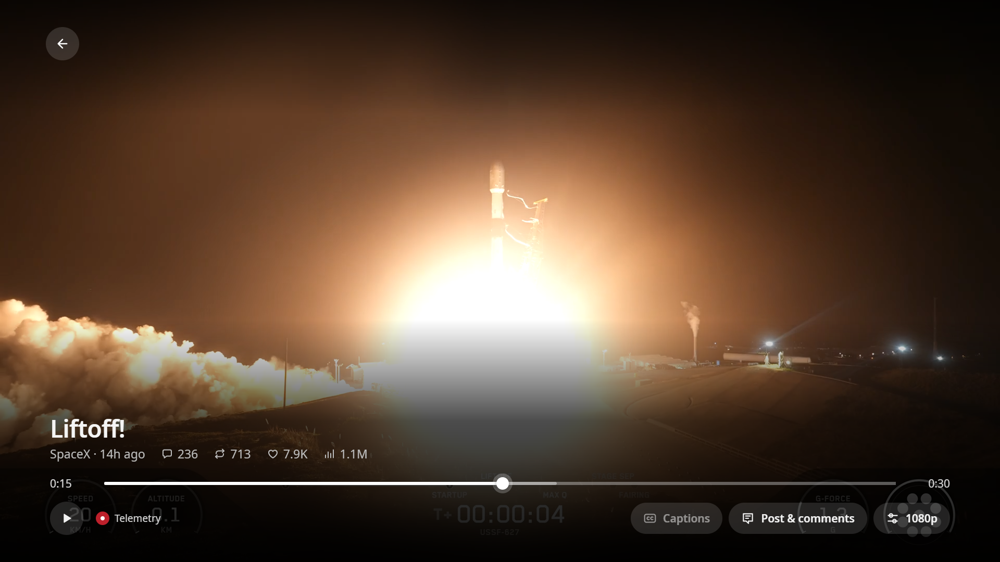

# Clicker

A TV app for LG webOS TVs that plays videos and live broadcasts from public X channels. No X login needed.



## 1. Set up your TV (once)

1. Create a free account at [webostv.developer.lge.com](https://webostv.developer.lge.com).
2. On the TV, open the **LG Content Store**, install **Developer Mode** and open it.
3. Sign in with your LG account.
4. Turn **Dev Mode Status** on. The TV restarts.
5. Open **Developer Mode** again and turn **Key Server** on.
6. Write down the **IP address** and **passphrase** shown on screen.

> Developer Mode switches itself off after a while. Open the app and press **Extend** to keep it on.

## 2. Set up your computer (once)

Install [Node.js](https://nodejs.org), then run these commands. Replace `192.168.1.20` with your TV's IP address.

```bash
npm install -g @webos-tools/cli
ares-setup-device --add mytv --info "{'host':'192.168.1.20','port':'9922','username':'prisoner'}"
ares-novacom --device mytv --getkey
```

When asked, type the passphrase from the TV.

## 3. Publish to your TV

```bash
git clone https://github.com/BieleckiLtd/Clicker.git
cd Clicker
npm run package
npm run tv:install
npm run tv:launch
```

Clicker now appears in your TV's app list. To update it later, run `git pull` and the last three commands again.

---

More detail: [development notes](docs/development.md). Third-party licences: [app/vendor/README.md](app/vendor/README.md).
